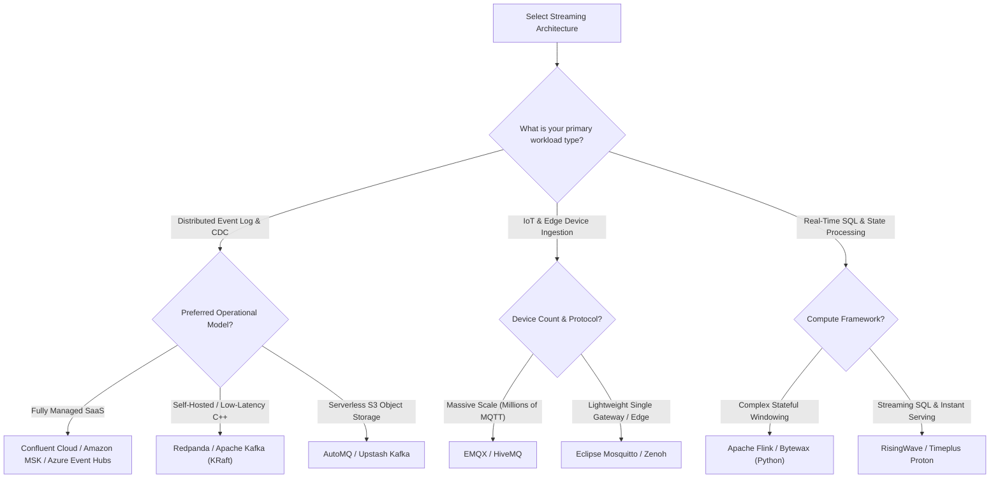

# 🚀 Awesome Event Streaming Platforms

**The Definitive Curated Directory of Distributed Logs, Pub/Sub Brokers, Stream Processing Engines & Real-Time Event Infrastructure**

*Explore the leading SaaS managed services and open-source distributed streaming systems powering modern real-time architectures, event-driven microservices, CDC (Change Data Capture), and AI/ML data ingestion pipelines.*

---

## 📑 Table of Contents

- [🌐 Sector Overview & Market Dynamics](#-sector-overview--market-dynamics)
- [☁️ SaaS & Fully Managed Platforms](#️-saas--fully-managed-platforms)
- [💻 Open-Source Streaming Projects](#-open-source-streaming-projects)
- [🧭 Platform Selection & Architecture Guide](#-platform-selection--architecture-guide)
- [🤝 How to Contribute](#-how-to-contribute)
- [💖 Support & Community](#-support--community)
- [⭐ Star History](#-star-history)
- [📜 Disclaimer](#-disclaimer)

---

## 🌐 Sector Overview & Market Dynamics

The global **Event Stream Processing (ESP) and Streaming Analytics market** is experiencing exponential expansion, valued at approximately **$5.3 billion in 2026** for core streaming infrastructure, with the adjacent real-time streaming analytics market surpassing **$53.2 billion** and compounding at **~26.6% CAGR**. This surge is propelled by the rapid enterprise adoption of real-time Agentic AI workflows, continuous ML feature stores, IoT telemetry networks, and distributed microservice event meshes.

From a market structure standpoint, the sector is **moderately concentrated around a de facto wire protocol standard (Apache Kafka)** while exhibiting a **hybrid cloud-hyper-scaler oligopoly**. Confluent, AWS (Amazon MSK), Microsoft (Azure Event Hubs), Google Cloud (Pub/Sub), and IBM dominate large-scale enterprise production revenue, bolstered by immense cloud lock-in and ecosystem gravity. Simultaneously, specialized high-performance contenders like **Redpanda** (C++ native execution), **AutoMQ** (S3-native serverless decoupling), and **HiveMQ** (industrial MQTT) actively capture growing niches where JVM memory footprints, multi-tenant protocol translation, or egress economics demand purpose-built alternatives.

---

## ☁️ SaaS & Fully Managed Platforms

The following table benchmarks the top commercially managed SaaS event streaming platforms. The entries are **sorted descending by company scale** (market capitalization or latest enterprise valuation).

| 🏢 Platform / Service | 💼 Vendor & Scale | 💳 Starting Tier Pricing | 🎁 Free Tier / Trial Limits | ⚙️ Protocol & Architecture Highlights |
| :--- | :--- | :--- | :--- | :--- |
| **[Azure Event Hubs](https://azure.microsoft.com/en-us/products/event-hubs/)** | **Microsoft** Market Cap: ~$3.10T Revenue: ~$245B+ | **$0.015/hour** per Throughput Unit (TU) + **$0.028 per 1M events** on Basic tier ($0.03/hr/TU on Standard for Kafka). | **Azure 30-Day Free Trial**: **$200 credit** usable for up to 20 TUs and 7-day retention on Standard namespaces before PAYG billing. | Native Azure event ingestion with transparent Apache Kafka 1.0+ wire protocol compatibility, capture to Azure Blob/Data Lake, and 90-day retention on Premium. |
| **[Google Cloud Pub/Sub](https://cloud.google.com/pubsub)** | **Alphabet / Google** Market Cap: ~$2.10T Revenue: ~$307B+ | **$40.00 per TiB** ($0.04/GiB) for the first 10 TiB of message throughput (publish + subscribe volume). | **Free Forever**: **10 GiB per month** of combined throughput across all topics; plus **$300 credit (90 days)** for new GCP signups. | Globally distributed serverless messaging with automatic horizontal sharding, exactly-once delivery, ordering keys, dead-letter topics, and BigQuery direct subscription. |
| **[Amazon MSK](https://aws.amazon.com/msk/)** | **Amazon / AWS** Market Cap: ~$1.90T Revenue: ~$575B+ | **$0.1869/broker-hour** (`kafka.m7g.large`, 3 AZs = **$0.5607/hr** / ~$410/mo) or Serverless at **$0.75/cluster-hour** + $0.10/GB in/out. | **AWS 30-Day Free Trial**: **$300 credit** applies toward MSK cluster compute; testing also supported via EC2 `t2.micro` Free Tier (750 hrs/mo for 12 mos). | Fully managed standard Apache Kafka service integrated with AWS IAM authentication, AWS KMS encryption, CloudWatch telemetry, and S3 tiered storage offloading. |
| **[IBM Event Streams](https://www.ibm.com/products/event-streams)** / **[IBM MQ](https://www.ibm.com/products/mq)** | **IBM** Market Cap: ~$225B Revenue: ~$62B+ | Event Streams Standard: **$0.09/instance-hour** (~$65/mo) + **$0.024/partition-hour**; IBM MQ SaaS: **$0.14/hour** (Small Broker). | **Free Forever Lite Plan**: 1 partition, **10 MB/s** ingestion throughput, 1-day retention, 1 GB storage cap; or IBM Cloud **$200 credit (30 days)**. | Enterprise-grade Apache Kafka deployment on IBM Cloud with Schema Registry support, coupled with classic IBM MQ enterprise transactional messaging. |
| **[Confluent Cloud](https://www.confluent.io/confluent-cloud/)** | **Confluent (IBM)** Acquisition: ~$11.13B ARR: ~$900M+ | Basic tier: **$0.00/hr cluster fee** (scales to 0); **$0.05/GB** ingress & egress; **$0.08/GB-mo** storage; $0.14/eCKU-hr (first eCKU free). | **30-Day Free Trial**: **$400 credit** with zero commitments to evaluate managed Kafka clusters, 120+ cloud connectors, and serverless Apache Flink. | The definitive cloud Kafka platform created by Kafka's inventors; features Stream Governance, Schema Registry, ksqlDB, and declarative stream processing via Apache Flink. |
| **[Aiven for Apache Kafka](https://aiven.io/kafka)** | **Aiven** Valuation: ~$3.00B Funding: ~$420M | **$0.27/hour** (~$195/month) for Startup-2 plan (single node, 80 GB storage); 3-broker HA Business-4 starts at **$0.48/hour** (~$350/mo). | **30-Day Free Trial**: **$300 credit** for provisioning managed Kafka clusters, MirrorMaker 2, Kafka Connect, and Karapace Schema Registry. | Multi-cloud turnkey managed Kafka deployed natively across AWS, GCP, and Azure with 99.99% SLA, zero-downtime upgrades, and Karapace open-source schema registry. |
| **[Redpanda Cloud](https://redpanda.com/cloud)** | **Redpanda Data** Valuation: ~$1.00B Funding: ~$266M | Serverless tier: **$0.10/cluster-hour** + **$0.045/GB written** (ingress) + **$0.04/GB read** (egress) + **$0.0015/partition-hour**. | **30-Day Free Trial**: **$100 credit** (no credit card required) capped at 100 MB/s ingress, 300 MB/s egress, 300 topics, and 5,000 partitions. | Zero-JVM, zero-ZooKeeper Kafka-compatible streaming engine written in C++; offers Serverless, Dedicated, and BYOC (Bring Your Own Cloud) deployments with sub-ms latencies. |
| **[Solace PubSub+ Cloud](https://solace.com/products/platform/)** | **Solace** Valuation: ~$600M Revenue: ~$100M+ | Dedicated instances scale via Platform Capacity Units from **~$0.45/broker-hour** or custom Foundation packages starting at **~$299/month**. | **30-Day Free Trial**: Enterprise-100 standalone cloud broker access; or **Free Forever Software Edition** (capped at 1,000 client connections & 800 GB spool). | Multi-protocol event mesh broker natively supporting MQTT, AMQP, JMS, REST, and Kafka bridging with deterministic routing, WAN optimization, and Event Portal governance. |
| **[HiveMQ Cloud](https://www.hivemq.com/pricing/)** | **HiveMQ GmbH** Valuation: ~$250M Funding: ~$43M | Starter plan starts at **$0.35/hour** (~$250/month) for dedicated broker runtime + **$0.80 per 1M messages** beyond base allowance. | **15-Day Free Trial**: Dedicated Starter cluster with **up to 10,000 connections**, 1 MB/s throughput, and TLS mutual auth (no credit card required). | Cloud-native enterprise MQTT broker purpose-built for connected vehicles, industrial IoT (IIoT), and smart devices with bi-directional streaming into Kafka. |
| **[Upstash Kafka](https://upstash.com/docs/kafka/overall/pricing)** | **Upstash** Valuation: ~$75M Funding: ~$10M | Pay-as-you-go serverless at **$0.60 per 100,000 messages** (capped at maximum **$120/month** per topic) + **$0.25/GB-month** storage. | **Free Forever**: Up to **10,000 messages/day**, 1 topic, 100 partitions, and 256 MB storage limit with zero credit card required. | True serverless Kafka designed for edge runtimes (Cloudflare Workers, Next.js, Vercel, AWS Lambda) featuring native HTTP/REST APIs alongside Kafka protocol. |

---

## 💻 Open-Source Streaming Projects

Curated collection of production-grade open-source distributed event streaming engines, stream processors, and message brokers. **Sorted strictly descending by GitHub Stars_Counts.**

### 1. 🥇 [Apache Kafka](https://github.com/apache/kafka) 
* **License**: Apache-2.0 | **Primary Language**: Java / Scala
* **Description**: The industry-standard distributed event streaming platform. Provides high-throughput, fault-tolerant, horizontally scalable append-only log architecture.
* **Core Strengths**: Deepest global ecosystem (Kafka Connect, Kafka Streams, ksqlDB), thousands of production battle tests, native KRaft consensus mode (eliminating external ZooKeeper dependencies), and exactly-once processing (EOS) semantics.
* **Ideal For**: Enterprise mission-critical event backbones, CDC pipelines, and core microservice asynchronous event buses.

### 2. 🥈 [Apache Flink](https://github.com/apache/flink) 
* **License**: Apache-2.0 | **Primary Language**: Java / Scala
* **Description**: Distributed processing engine for stateful stream processing over unbounded and bounded data streams.
* **Core Strengths**: True event-driven stream processing with sub-second latencies, stateful stream computations with checkpointing (Chandy-Lamport variant), expressive event-time windowing semantics, and native streaming SQL.
* **Ideal For**: Real-time fraud detection, continuous ML feature generation, stream joins, and real-time operational telemetry.

### 3. 🥉 [Apache RocketMQ](https://github.com/apache/rocketmq) 
* **License**: Apache-2.0 | **Primary Language**: Java
* **Description**: Financial-grade distributed messaging and streaming platform designed for ultra-high throughput and predictable low latency.
* **Core Strengths**: Native 2-phase commit distributed transactions, scheduled/delay messaging, billions-level message accumulation without performance degradation, and lightweight architectural overhead.
* **Ideal For**: E-commerce order pipelines, fintech transactional messaging, and large-scale asynchronous decoupling.

### 4. ⚡ [NATS Server](https://github.com/nats-io/nats-server) 
* **License**: Apache-2.0 | **Primary Language**: Go
* **Description**: Cloud-native, high-performance pub/sub messaging system with minimal resource footprints.
* **Core Strengths**: Includes **JetStream** persistence layer for durable message streams, consumer deduplication, key-value and object stores, sub-millisecond dispatching, and zero-configuration clustering across multi-cloud/edge topologies.
* **Ideal For**: Cloud-native Kubernetes microservices, edge computing, distributed RPC, and real-time telemetry streaming.

### 5. 🌐 [EMQX](https://github.com/emqx/emqx) 
* **License**: Apache-2.0 | **Primary Language**: Erlang
* **Description**: Massive-scale distributed MQTT 5.0 broker and real-time streaming engine for IoT and connected mobility.
* **Core Strengths**: Scales to 100M+ concurrent MQTT connections per cluster, sub-millisecond message routing, built-in SQL-based data manipulation rules engine, and out-of-the-box data bridges to Kafka, Pulsar, and time-series databases.
* **Ideal For**: Connected vehicles (V2X), smart energy grids, industrial automation, and large-scale IoT fleets.

### 6. 🌊 [Apache Pulsar](https://github.com/apache/pulsar) 
* **License**: Apache-2.0 | **Primary Language**: Java
* **Description**: Next-generation distributed pub-sub messaging and streaming platform built on a disaggregated compute-and-storage architecture.
* **Core Strengths**: Separates stateless brokers from stateful bookies (Apache BookKeeper), enabling instant node scale-out, seamless multi-tenancy, cross-datacenter geo-replication, and automated tiered storage offloading to S3/GCS.
* **Ideal For**: Enterprise multi-tenant streaming infrastructure, unified queuing + streaming, and cold storage log retention.

### 7. 🐇 [RabbitMQ](https://github.com/rabbitmq/rabbitmq-server) 
* **License**: MPL-2.0 | **Primary Language**: Erlang
* **Description**: The world's most widely deployed traditional message broker, supporting AMQP 0-9-1, AMQP 1.0, MQTT, and STOMP.
* **Core Strengths**: Flexible routing algorithms (direct, topic, fanout, headers), reliable delivery guarantees, extensive management UI, and **RabbitMQ Streams** (high-throughput append-only log streaming).
* **Ideal For**: Complex routing topologies, task worker queues, enterprise microservices, and mixed message-queue + streaming workloads.

### 8. 🐼 [Redpanda](https://github.com/redpanda-data/redpanda) 
* **License**: BSL-1.1 (Community Edition Free) | **Primary Language**: C++
* **Description**: Modern Kafka API-compatible streaming platform engineered in C++ with a thread-per-core, shared-nothing Seastar architecture.
* **Core Strengths**: 100% native Kafka wire protocol compatibility without JVM overhead, zero ZooKeeper/KRaft cluster dependencies, 10x faster tail latencies, up to 3x compute cost savings, and built-in Wasm data transformations.
* **Ideal For**: High-throughput, ultra-low latency streaming, edge deployments, and dropping in as a painless Kafka replacement.

### 9. 🦟 [Eclipse Mosquitto](https://github.com/eclipse-mosquitto/mosquitto) 
* **License**: EPL-2.0 / EDL-1.0 | **Primary Language**: C
* **Description**: Ultra-compact, fast open-source message broker implementing MQTT protocols 5.0, 3.1.1, and 3.1.
* **Core Strengths**: Negligible RAM footprint (~few megabytes), native C efficiency, wide platform portability, TLS/SSL authentication, and bridge connections to upstream enterprise brokers.
* **Ideal For**: Embedded single-board computers (Raspberry Pi), smart home hubs, edge gateways, and resource-constrained environments.

### 10. ☁️ [AutoMQ](https://github.com/AutoMQ/automq) 
* **License**: Apache-2.0 | **Primary Language**: Java
* **Description**: Cloud-first, truly serverless Kafka alternative redesigned from the ground up on object storage (AWS S3, GCP Cloud Storage, Azure Blob).
* **Core Strengths**: 100% Kafka wire compatibility with zero local disks, single-digit millisecond latency backed by EBS WAL, auto-scaling brokers in seconds, and up to 10x infrastructure cost savings.
* **Ideal For**: Cloud-native Kafka deployments seeking to eliminate disk rebalancing, partition management, and provisioned storage costs.

### 11. 📈 [RisingWave](https://github.com/risingwavelabs/risingwave) 
* **License**: Apache-2.0 | **Primary Language**: Rust
* **Description**: Distributed streaming SQL database designed for real-time stream processing, continuous materialized views, and sub-second analytical serving.
* **Core Strengths**: Native PostgreSQL wire protocol compatibility, real-time ingestion from Kafka/Pulsar/Kinesis, cascading incremental computations, and disaggregated compute-storage architecture.
* **Ideal For**: Real-time dashboards, dynamic pricing calculation, continuous metric aggregation, and streaming ETL without managing complex Flink jobs.

### 12. ⚡ [Eclipse Zenoh](https://github.com/eclipse-zenoh/zenoh) 
* **License**: EPL-2.0 / Apache-2.0 | **Primary Language**: Rust
* **Description**: High-performance, zero-overhead pub/sub/query protocol unifying data in motion, data in use, and data at rest across edge-to-cloud continuums.
* **Core Strengths**: Minimal wire protocol overhead (down to 4-5 bytes per packet), native peer-to-peer and brokered topologies, and automated bridging into ROS 2, MQTT, DDS, and Kafka.
* **Ideal For**: Robotics, autonomous driving, connected vehicles, and WAN-spanning edge-to-cloud data meshes.

### 13. 🌊 [Numaflow](https://github.com/numaproj/numaflow) 
* **License**: Apache-2.0 | **Primary Language**: Go
* **Description**: Kubernetes-native, language-agnostic stream processing and event-driven computing engine.
* **Core Strengths**: Native Kubernetes CRDs (Custom Resource Definitions), backpressure-driven auto-scaling of pods to zero, and polyglot user-defined functions (Python, Go, Java, Rust, C++).
* **Ideal For**: Kubernetes-native stream workflows, real-time ML inference, and modular event transformation graphs.

### 14. 🏛️ [Apache ActiveMQ](https://github.com/apache/activemq) 
* **License**: Apache-2.0 | **Primary Language**: Java
* **Description**: The classic, battle-hardened open-source multi-protocol message broker and JMS implementation.
* **Core Strengths**: Full JMS 1.1 and JMS 2.0 compliance, support for AMQP, STOMP, MQTT, and OpenWire protocols, alongside the modern non-blocking ActiveMQ Artemis engine.
* **Ideal For**: Enterprise Java EE application migration, legacy ESB integration, and enterprise banking/insurance messaging.

### 15. ⏱️ [Timeplus Proton](https://github.com/timeplus-io/proton) 
* **License**: Apache-2.0 | **Primary Language**: C++
* **Description**: Fast, lightweight streaming SQL engine built on ClickHouse core, combining real-time streaming queries with historical table lookups.
* **Core Strengths**: Single static binary deployment, sub-millisecond query evaluation, streaming aggregations, and unified SQL syntax for both historical and in-flight Kafka data.
* **Ideal For**: Real-time log analytics, edge stream processing, alerting rules, and observability pipelines.

### 16. 🐍 [Bytewax](https://github.com/bytewax/bytewax) 
* **License**: Apache-2.0 | **Primary Language**: Rust / Python
* **Description**: Stateful stream processing framework for Python, powered by the Timely Dataflow distributed execution engine written in Rust.
* **Core Strengths**: Native Python ergonomics with Rust-grade parallelism and memory efficiency; simplifies writing complex stateful data transformations without Java or JVM overhead.
* **Ideal For**: Real-time Python ML feature engineering, AI embedding pipelines, streaming anomalies, and data science workflows.

### 17. 🐝 [HiveMQ Community Edition](https://github.com/hivemq/hivemq-community-edition) 
* **License**: Apache-2.0 | **Primary Language**: Java
* **Description**: 100% MQTT 3.x and MQTT 5.0 compliant open-source message broker core.
* **Core Strengths**: Highly extensible plugin SDK, rock-solid conformance to OASIS MQTT standards, robust backpressure handling, and enterprise bridging pathways.
* **Ideal For**: Self-hosted MQTT IoT ingestion, developer sandboxes, and connected hardware prototyping.

---

## 🧭 Platform Selection & Architecture Guide

| Decision Metric | Recommended Choices | Key Tradeoff |
| :--- | :--- | :--- |
| **Industry Standard & Deepest Ecosystem** | **Apache Kafka** / **Confluent Cloud** | Comprehensive tooling and connector availability, but higher operational tuning. |
| **Sub-Millisecond p99 Latency & Zero JVM** | **Redpanda** | C++ performance and zero-ZooKeeper simplicity, commercial features under BSL. |
| **Object-Storage Decoupled Economics** | **AutoMQ** | 10x cost reduction on AWS/GCP storage, requires fast object store latency. |
| **Multi-Tenancy & Independent Compute/Storage** | **Apache Pulsar** | Flexible storage isolation via BookKeeper, slightly higher initial architectural footprint. |
| **IoT & Telemetry Scale (MQTT 5.0)** | **EMQX** / **HiveMQ** | Exceptional high-concurrency connection density, specialized for MQTT rather than Kafka logs. |
| **Minimal Footprint Edge Messaging** | **Eclipse Mosquitto** / **NATS** | Lightweight footprint and quick deployment, lacks built-in Kafka ecosystem connectors. |
| **Real-time SQL Analytics & Materialized Views** | **RisingWave** / **Timeplus Proton** | Postgres-compatible streaming SQL queries, focused on stream analytics rather than raw pub/sub brokers. |

---

## 🤝 How to Contribute

We welcome additions, corrections, and benchmark improvements from the real-time data community!

1. 🍴 **Fork the repository** on GitHub.
2. 🌿 **Create a descriptive feature branch** (`git checkout -b feature/add-new-platform`).
3. ✍️ **Update [README.md](README.md)**:
   - For **SaaS**: Add complete pricing with specific starting tier prices and explicit free tier/trial duration and quota limits in the benchmark table.
   - For **Open-Source**: Provide the GitHub repo, description, key strengths, and an official `img.shields.io` Stars_Badge linking to the `/stargazers` page.
4. 🧪 **Verify markdown rendering, links, and table formatting**.
5. 🚀 **Submit a Pull Request** with a concise description of why the project belongs in the ecosystem guide.

---

## 💖 Support & Community

Thank you for exploring and utilizing the **Awesome Event Streaming Platforms** directory! Maintaining, benchmarking, and curating this guide requires continuous effort and research across the rapidly evolving distributed streaming and real-time data ecosystem.

If you find this resource helpful for your work, team, or personal projects, please consider supporting the project:

- ⭐ **Star this repository** to improve visibility and help other data engineers discover it.
- 🍴 **Fork the project** and contribute additions, corrections, or benchmarks.
- 📢 **Share it** on LinkedIn, X/Twitter, Reddit, Discord, or with your engineering team.
- ☕ **Buy me a coffee / Sponsor**: If you'd like to support ongoing open-source maintenance, you can contribute via the GitHub Sponsors Dashboard below:

*Every bit of support fuels more comprehensive benchmarks, deeper architecture guides, and timely ecosystem updates!*

---

##  Star History

---

## 📜 Disclaimer

* This repository is an independent, community-driven curated directory. Product names, logos, and brands are property of their respective owners.
* Cloud pricing, starting rates, and free tier allowances reflect verified vendor terms as of October 2026 and are subject to change. Always verify current commercial terms directly on provider pricing pages prior to production sizing.
* *Notice on legacy services*: CloudKarafka has reached official end-of-life / discontinuation status and is excluded from recommended production listings.

---

**Built with ❤️ for real-time data engineers, platform architects, IoT builders, and distributed systems hackers.**

⭐ Star this repository if it helped optimize your streaming architecture!

